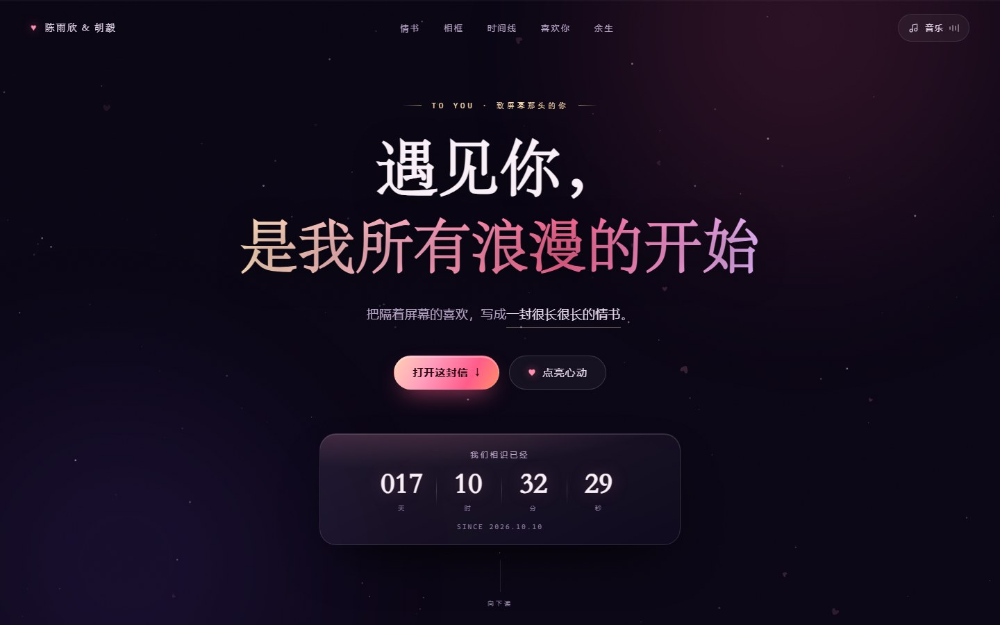
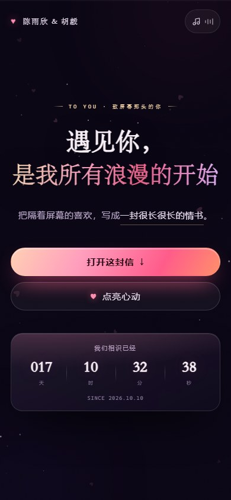
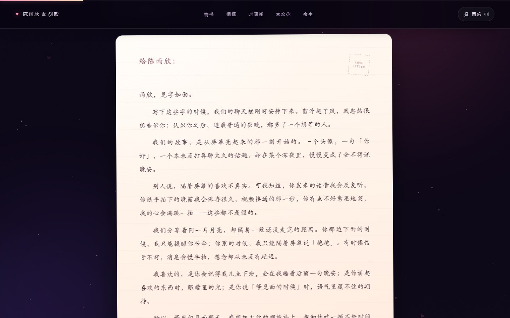
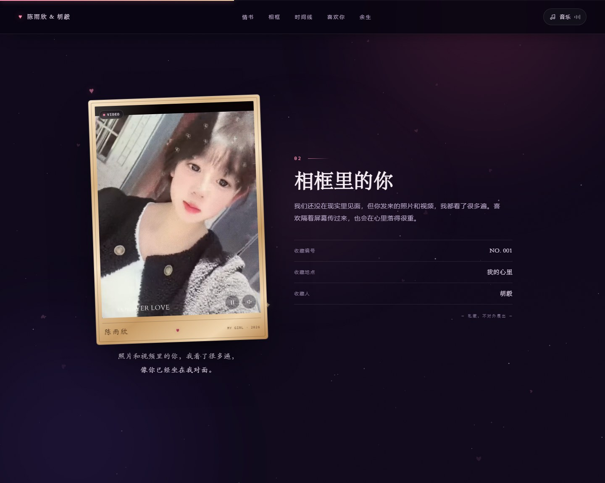

# 致陈雨欣 · 一封很长的情书

一个纯前端、写给「屏幕那头」的恋爱网页：暗色浪漫、玻璃质感、手写网恋情书、能放照片和视频的金色相框、异地时间线、心动值小实验、余生清单，还有一个会逃跑的「再想想」按钮。

不用安装任何依赖，双击 `index.html` 就能打开。

## 预览



<p align="center">
  
</p>

### 情书预览



### 相框预览



> 相框里现在是陈雨欣的视频（13 秒，已增强到 1080p，自动静音循环）；点右下角可以暂停，点小喇叭打开声音。`assets/yuxin.jpg` 是从增强后的视频里截的封面。

---

## 一、打开方式

1. 直接双击 `D:\love-website\index.html`（推荐用 Edge / Chrome）。
2. 如果想像线上一样访问，也可以在本目录执行任意静态服务器，例如：
   ```powershell
   python -m http.server 8080
   ```
   然后打开 `http://localhost:8080`。

> 页面不加载任何外部字体、图片或接口，断网也能完整运行。

---

## 二、把网页变成你们的故事

**只需要改一个文件：`js/config.js`。** 保存后刷新页面即可。

| 想改什么 | 在 `config.js` 里找 | 说明 |
| --- | --- | --- |
| 对方的名字 | `you.name` | 会出现在首屏、信纸称呼、页脚 |
| 你的名字 | `me.name` | 落款、页脚 |
| 相识的日期 | `startDate` | 格式 `2026-10-10T00:00:00`，首页「我们相识已经 xxx 天」以此计算 |
| 首屏标题 | `hero` | 标题分两行，第二行自动做玫瑰金渐变 |
| 情书内容 | `letter` | 一个字符串一段，想让信更长就继续加段落 |
| 落款日期 | `letterDate` | 留空会自动显示打开页面的当天；也可固定成 `2024 年 5 月 20 日` |
| 她的照片 | `photo` | 把照片放到 `assets/yuxin.jpg` 会自动显示；相框题签、说明、收藏信息也都可改 |
| 她的视频 | `photo.video` | 把视频放到 `assets/yuxin.mp4`；有视频时优先播放，照片作为封面 |
| 恋爱时间线 | `timeline` | 每项有 `date` / `title` / `text`，想加几段加几段 |
| 喜欢你的理由 | `reasons` | `icon` 可选 `heart` / `moon` / `coffee` / `music` / `sun` / `star` |
| 心动实验室文案 | `lab` | 标题、说明、满分结果 |
| 余生清单 | `bucket` | 一个字符串一条，勾选进度会本地保存 |
| 求婚文案 | `proposal` | 标题、按钮文字、逃跑按钮的台词、答应后的文案 |

### 把她的照片 / 视频放进相框

> 当前 `assets/yuxin.jpg` 和 `assets/yuxin.mp4` 已经放好；要换照片或视频，同名覆盖即可。

1. **照片**：选一张竖版 **3:4** 的照片，命名为 `yuxin.jpg`，放进 `assets/` 文件夹；分辨率建议不低于 **1200 × 1600**。
2. **视频**：选一段竖版 **3:4** 的短视频，命名为 `yuxin.mp4`，放进 `assets/` 文件夹；推荐 H.264 编码，时长 10–30 秒、体积不要太大。
3. 两个文件都放时，相框会优先播放视频，照片作为视频加载前的封面；只放其中一个也可以。
4. 视频默认静音循环播放，右下角可以播放/暂停、开关声音；如果浏览器拦截自动播放，中间会出现一个播放按钮。
5. 也可以放 `.webm` 等格式：改 `config.js` 里的 `photo.video` 即可。想换文件名，改 `photo.src` / `photo.video`。
6. 如果照片或视频里的脸被裁掉了，调 `photo.position`（比如 `'center 20%'`）；相框题签、说明、收藏卡信息在 `photo.plaqueName` / `photo.caption` / `photo.facts` 里改。
7. 没有照片也没有视频时，会显示 `assets/photo-placeholder.svg` 里的占位插画。

### 常见小修改

- **章节标题**（「一封写给你的信」等）和章节说明在 `index.html` 里，搜索对应的中文即可。
- **配色**在 `css/style.css` 顶部的 `:root` 里：`--rose` 是主玫瑰色，`--gold` 是香槟金，`--bg-0` 等是背景色。
- **字体**同样在 `:root`：`--serif`（标题）、`--hand`（手写情书）、`--sans`（正文）。
- **背景音乐**是页面实时合成的轻音乐，不需要音频文件；点右上角「音乐」才会响，音量刻意调得比较轻。

---

## 三、页面上有什么

- **首屏**：星空、飘落的心、渐变标题、从相识那天起的天数/时/分/秒实时计时。
- **情书**：奶油色信纸、手写字体、火漆印章，写的是隔着屏幕认识彼此的那段日子。
- **相框**：金色相框 + 木质题签，可以放照片或短视频；有视频时优先播放，没有文件时显示同色系占位插画。
- **时间线**：从聊天框里的第一句话，到第一次听见她的声音。
- **喜欢你的理由**：六张会轻轻上浮的卡片。
- **心动实验室**：点亮五颗心，把心动值填到 100%，会有爱心炸开。
- **余生清单**：可勾选，进度保存在浏览器本地（`localStorage`），刷新不丢。
- **最后一个问题**：「愿意」会放大；「再想想」会躲开鼠标，越躲越小。
- **答应的那一刻**：全屏爱心庆祝 + 火漆印章贺卡；按 `Esc` 或点空白处可以关闭。
- **细节**：阅读进度条、跟随光标的光晕、滚动显现、移动端适配、`prefers-reduced-motion` 支持。

---

## 四、文件结构

```
love-website/
├─ index.html        页面结构
├─ favicon.svg       浏览器标签页小爱心
├─ preview-desktop.jpg
├─ preview-mobile.jpg
├─ preview-letter.jpg
├─ preview-photo.jpg
├─ assets/
│  ├─ yuxin.jpg      ← 她的照片（放进来就会自动显示）
│  ├─ yuxin.mp4      ← 她的视频（有视频时优先播放）
│  └─ photo-placeholder.svg  没有文件时的占位插画
├─ css/
│  └─ style.css      全部视觉样式
├─ js/
│  ├─ config.js      ← 你唯一需要改的文件
│  └─ main.js        渲染、计时、星空、音乐与各种小交互
└─ README.md
```

---

## 五、小提醒

- 音乐需要浏览器允许用户点击后才能播放；如果没声音，再点一次右上角的「音乐」。
- 页面在 `file://` 下打开也能用，但个别浏览器对本地文件的 `localStorage` 限制不同；勾选状态如果没保存，不影响其它功能。
- 想在手机上打开：把整个 `love-website` 文件夹放到任意静态托管（GitHub Pages、Vercel、Netlify 等）即可，无需构建。
- 如果只是想做一张会动的电子情书，直接双击打开、改完名字，就可以送出去了。

---

写这封情书的人，比网页本身更重要。

♥
